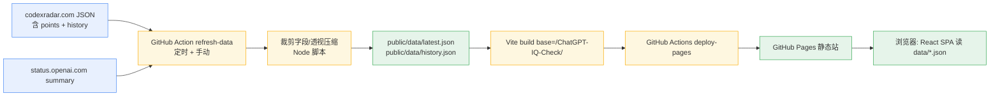

# ChatGPT IQ Check（降智雷达）— 设计规格

- 状态：待用户审阅
- 日期：2026-10-23
- 仓库：`dev-of-mc-yzy15/ChatGPT-IQ-Check`（GitHub Pages 静态托管，AGPL-3.0）

## 1. 目标与非目标

### 目标
做一个**纯前端**的"降智雷达"网站：以**实时 IQ** 为核心，展示各模型（含 ChatGPT/GPT 系列）在不同推理档位下的当前智力分、耗时、成本、通过率，并借助数据源自带的**历史时间序列**呈现 IQ 趋势曲线、直观反映"降智"（智力下降）现象。全站静态托管到 GitHub Pages，数据由 GitHub Actions 定时抓取并构建。

### 非目标（明确不做）
- **不自建评测/检测引擎**：不自己跑模型评测，不自己实现"降智判定"的滚动基线算法。降智信号完全来自数据源。
- 不做后端服务、不做数据库、不存密钥。
- 不直接连各模型 API 逐个测试。

## 2. 数据来源（均已实测：匿名可拉，无需密钥）

| 源 | 地址 | 用途 | 备注 |
|---|---|---|---|
| CodexRadar | `https://codexradar.com/data/intelligence-efficiency.json` | 实时 IQ / 档位 / 通过率 / 耗时 / 成本 + **历史趋势** `history[]` | 原始 ~9.4MB / 30 万行，Actions 侧裁剪 |
| OpenAI Status | `https://status.openai.com/api/v2/summary.json` | 官方各服务组件健康状态 + incidents（顶部横幅） | Statuspage 公开 JSON |

CodexRadar 关键字段（顶层）：`schema, mode, source_updated_at, points[], history[]`。
- `points[]`（当前快照）：`model, effort(low/medium/high/xhigh/max/ultra), harness, iq, passed, valid_tasks, average_price_usd, average_minutes, latest_graded_at, total_runs` 等。
- `history[]`（时间序列，实测自 2026-07-23 起）：每项 `{ at: ISO时间, points: [{ model, effort, iq, passed, valid_tasks, average_price_usd, average_minutes, ... }] }`。**趋势曲线与降智展示直接消费此数组，无需自行累积。**

## 3. 整体架构与数据流



要点：浏览器绝不直连第三方（体积 + 跨域）。抓取/裁剪全在 Actions 内完成，产出精简 JSON 供静态站消费。

## 4. GitHub Actions 工作流

单一 main 分支。两个 workflow：

### 4.1 `refresh-data.yml`
- 触发：`schedule`（默认每 1 小时，cron `0 * * * *`）+ `workflow_dispatch`。
- 步骤：checkout → setup-node → 运行 `scripts/refresh.mjs`：
  1. 拉 CodexRadar + OpenAI Status 两个 URL（带重试/超时）。
  2. 生成 `public/data/latest.json`：当前 `points`（保留展示所需字段 + 计算 `recommend_score = iq − 1.5 × average_minutes`）+ `status` 摘要 + 从 `history` 派生的**轻量 Δ 徽标**（仅"当前 iq vs N 天前 iq"的差值，纯展示）。
  3. 生成 `public/data/history.json`：**全保真**（不做时间降采样）。实测 history 仅 ~416 快照 / ~16277 点，体积虚胖源于每点 ~16 冗余字段 + 美化格式；因此只做三件事即可把体积压到 ~240KB：①字段裁剪（保留 `at`，每条 series 保留 `iq`，可选 `pass_rate/avg_minutes/avg_price_usd`）；②透视成 `series[]`（model×effort 字符串不再逐点重复）；③压缩 JSON（不格式化）。趋势曲线保留完整分辨率。
  4. 失败容错见 §7。
  5. 若有变化，commit `public/data/` 回 main，commit message 带 `[skip ci]` 避免与 deploy 触发循环。
- 权限：`contents: write`（提交数据）。使用专用 SSH 密钥（项目 SCM 约定 `dev-of-mc-yzy15`）或默认 `GITHUB_TOKEN`——**具体用哪个由用户在实现/启用前确认**。

### 4.2 `deploy.yml`
- 触发：`push`（main，路径含源码或 `public/data/`）+ `workflow_dispatch`。
- 步骤：checkout → setup-node → `npm ci` → `npm run build`（Vite `base=/ChatGPT-IQ-Check/`）→ `actions/configure-pages` → `actions/upload-pages-artifact`（`dist/`）→ `actions/deploy-pages`。
- 权限：`pages: write`、`id-token: write`。

## 5. 前端（React + TypeScript + Vite）

- 栈：React 18 + TypeScript（能写 TS 不用 JS）+ Vite；图表用 Recharts；样式 CSS Modules 或原生 CSS 变量（含深/浅色主题）。
- 数据加载：`fetch(\`${import.meta.env.BASE_URL}data/latest.json\`)` 与 `history.json`；无运行时后端调用。
- 页面区块（参照样例站信息架构，风格不必一致）：
  1. **顶部状态横幅**：来自 OpenAI Status（indicator + 关键组件状态 + 最近 incident + 更新时间）。
  2. **今日推荐**：按 `recommend_score` 给出"最聪明 / 性价比 / 最快"三选，显示 IQ、平均耗时、平均成本、通过率。
  3. **综合推荐表**：可排序列（模型/档位/IQ/耗时/成本/通过率/推荐分），支持点击表头排序。
  4. **智力天梯**：按 IQ 降序列表。
  5. **速度天梯**：按平均耗时升序列表。
  6. **IQ 趋势曲线**：消费 `history.json`，按 model×effort 多线展示；降智点（Δ 为负且超显示阈值）标红。
  7. 页脚：`source_updated_at` / 抓取时间 / 数据来源外链 / 免责声明。

### 组件划分（便于独立理解与测试）
- `data/loader.ts`：拉取与校验 JSON，返回类型化数据；错误/空态处理。
- `lib/derive.ts`：纯函数——排序、推荐分、Δ 徽标计算、趋势数据透视（表驱动单测覆盖）。
- `components/`：`StatusBanner` / `TodayPicks` / `RecommendTable` / `IQLadder` / `SpeedLadder` / `TrendChart` / `ThemeToggle`。
- `types.ts`：与 §6 数据契约对应的类型定义。

## 6. 数据契约（Actions 产出）

### `public/data/latest.json`
```jsonc
{
  "generated_at": "ISO8601",
  "source_updated_at": "ISO8601",
  "models": [
    { "model": "gpt-6-astra", "effort": "high", "harness": "codex",
      "iq": 110.36, "passed": 103, "valid_tasks": 140, "pass_rate": 0.7357,
      "avg_price_usd": 2.814112, "avg_minutes": 13.77, "recommend_score": 89.7,
      "iq_delta_7d": -4.2, "latest_graded_at": "ISO8601", "total_runs": 146 }
  ],
  "status": {
    "indicator": "none",
    "description": "All Systems Operational",
    "components": [ { "name": "Codex in ChatGPT Desktop", "status": "operational" } ],
    "incidents": [ { "name": "...", "status": "resolved", "updated_at": "ISO8601" } ]
  }
}
```

### `public/data/history.json`
```jsonc
{
  "series": [
    { "model": "gpt-6-astra", "effort": "high",
      "points": [ { "at": "ISO8601", "iq": 108.2, "pass_rate": 0.72,
                    "avg_minutes": 14.1, "avg_price_usd": 2.7 } ] }
  ]
}
```

## 7. 错误处理与降级

- 任一源拉取失败：重试（3 次指数退避）。仍失败则**保留上一次已 commit 的 `public/data/*.json`**，不覆盖为坏数据；站点照常显示旧数据（静态托管天然具备）。
- CodexRadar 若 `iq` 为 `null` 或样本数为 0：该 model×effort 标为"数据不足"，从排行剔除但保留原始条目以便追溯。
- 字段缺失/新增：`scripts/refresh.mjs` 对输入做防御性解析（可选链 + 默认值），不因上游加字段而崩。
- 前端：`loader.ts` 对 fetch 失败 / JSON 结构异常给出空态与错误提示，不白屏。

## 8. 测试策略

- 单元（Vitest，纯函数为主，表驱动）：
  - `derive.ts`：推荐分公式、排序稳定性、Δ 计算边界（缺历史/单点/极端值）、透视降采样。
  - `refresh.mjs` 的裁剪/降采样函数：正常/超大 history/空 history/字段缺失。
- 契约：用一份从 CodexRadar 实拉的样本 fixture 断言裁剪输出符合 §6 契约。
- 端到端（可选，后续）：Playwright 打开 build 产物，断言各区块渲染与排序交互。
- 不做：真实模型评测、对第三方源的自动化 live 测试（避免过度抓取）。

## 9. 约束与红线

- 许可：AGPL-3.0（仓库已有），纯静态不引入额外限制。
- **不自动 push、不开 Pages、不触发部署**：任何推送到 GitHub / 启用 Actions / 部署 Pages 的操作，须经用户本人明确确认后执行。实现阶段仅在本地写文件与（可选）本地 commit。
- 全程无密钥、不自跑评测。

## 10. 交付物清单（实现阶段）

- `package.json` / `tsconfig.json` / `vite.config.ts`（`base=/ChatGPT-IQ-Check/`）
- `index.html` + `src/`（React 组件、`lib/`、`data/`、`types.ts`、主题样式）
- `scripts/refresh.mjs`（抓取 + 字段裁剪 + 透视压缩 + 容错）
- `.github/workflows/refresh-data.yml`、`.github/workflows/deploy.yml`
- `public/data/latest.json`、`public/data/history.json`（首次可由 refresh 本地生成一份种子数据）
- `README.md`（本地开发、数据刷新、Pages 部署、需用户确认的启用步骤）
- 测试：`*.test.ts` + fixture
