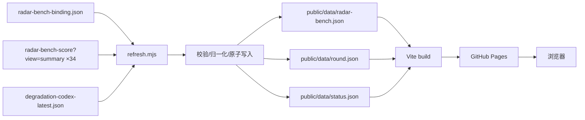

# ChatGPT IQ Check（降智雷达）— 设计规格 v2

- 状态：已实现
- 实现落于 commit 99bf530 之后，以 git log 为准
- 日期：2026-10-24
- 取代：`2026-10-23-chatgpt-iq-radar-design.md`（v1）
- 仓库：`dev-of-mc-yzy15/ChatGPT-IQ-Check`（GitHub Pages 静态托管，AGPL-3.0）

## 1. 目标与非目标

### 目标

做一个**纯前端**的「降智雷达」静态站，数据来自 CodexRadar 当前公开的实时接口，包含两块核心视图：

1. **本轮雷达**：复刻 codexradar.com 首页的 7 题一轮看板——6 个模型 × 34 个候选档位的本轮分数、逐题 reward、耗时、成本、动画盲评。
2. **RadarBench 趋势**：64 题 RadarBench 的逐候选分数、覆盖率、评分状态、日桶历史，以及「分数下降」信号的可视化。

两块视图的指标**分开命名**：7 题看板叫「本轮雷达分」，64 题叫「RadarBench 分数」。两者都不叫「IQ」，也不互相换算。

### 非目标（明确不做）

- **不自建评测/检测引擎**：不自己跑模型，不自己实现降智判定。
- **不使用旧 fallback 文件作为主数据源**：`/data/intelligence-efficiency.json` 已停在 2026-10-01，只服务于站点上一个隐藏的 `station-preview` 区块；本项目不消费它。
- **不调用已退役接口**：`/api/v1/table`、`/api/v1/radar-bench` 已返回 410；`/api/intelligence-efficiency-metrics`、`/api/radar-insights` 当前 502。
- 不做后端服务、不做数据库、不存密钥。
- 不直接连各模型 API 逐个测试。

## 2. 数据源（2026-10-24 实测）

### 2.1 候选目录

```text
GET https://codexradar.com/data/radar-bench-binding.json
HTTP 200 · 24,054 B · application/json
```

关键字段：

```jsonc
{
  "enabled": true,
  "interface_confirmed": true,
  "production_read_verified": true,
  "benchmark": "radar-bench-final64-20261004",
  "catalog_version": "dradar-four-library-deployment007-server024-20261004-config64",
  "task_set_sha256": "f75ff09b...",
  "total_tasks": 64,
  "total_cells": 320,
  "score_version": "radar-bench-v2-150",
  "score_max": 150,
  "model_efforts": [ { "model": "gpt-6.1-sol", "effort": "low" }, ... ], // 34 项
  "members": [ { "source_benchmark": "...", "collection_id": "...", "task_id": "...", "task_content_hash": "..." }, ... ], // 64 项
  "active_display_selection": { "model": "gpt-6.1-sol", "effort": "low" },
  "public_api_observed_at": "2026-10-04T12:07:35Z"
}
```

`model_efforts` 是候选清单的**唯一权威来源**。当前 34 个组合：

| 模型 | 档位 |
|---|---|
| `gpt-6-astra` | low / medium / high / xhigh / max / ultra |
| `gpt-6.1-sol` | low / medium / high / xhigh / max / ultra |
| `gpt-6-sol` | low / medium / high / xhigh / max / ultra |
| `gpt-6-luna` | low / medium / high / xhigh / max |
| `gpt-5.6-sol` | low / medium / high / xhigh / max / ultra |
| `gpt-5.6-luna` | low / medium / high / xhigh / max |

### 2.2 单候选实时分数 + 日桶历史

```text
GET https://codexradar.com/api/radar-bench-score
    ?model=<model>&effort=<effort>&view=summary&selection=user-selected-v1
HTTP 200 · ~3,792 B · application/json · Cache-Control: no-store
```

关键字段：

```jsonc
{
  "schema": "radar-bench-public-summary-v6-150-details",
  "benchmark": "radar-bench-final64-20261004",
  "score_version": "radar-bench-v2-150",
  "score_max": 150,
  "catalog_version": "...",
  "task_set_sha256": "...",
  "model": "gpt-6-astra",
  "effort": "high",
  "score": 104.56151352837776,
  "coverage": 64,
  "required_tasks": 64,
  "score_status": "complete",              // complete | provisional
  "graded_runs_count": 101,
  "source_counts": { "deepswe": 15, "pompeii": 16, "tb4": 14, "science": 19 },
  "source_scores": {
    "deepswe": { "score": 105, "coverage": 15, "required_tasks": 15, "graded_runs_count": 21 },
    "pompeii": { "score": 129.18, "coverage": 16, "required_tasks": 16, "graded_runs_count": 22 },
    "tb4": { "score": 101.79, "coverage": 14, "required_tasks": 14, "graded_runs_count": 16 },
    "science": { "score": 85.53, "coverage": 19, "required_tasks": 19, "graded_runs_count": 42 }
  },
  "statistics": {
    "sample_count": 101,
    "metrics": {
      "elapsed_ms": { "mean": 835906.3177, "total": 84426538.09 },
      "api_equivalent_usd": { "mean": 3.5785, "total": 361.4268 }
    }
  },
  "detail_metrics": {
    "valid_grade_events": 101,
    "latest_graded_at": "2026-10-23T01:19:00.816645Z",
    "as_of": "2026-10-23T17:01:10.589Z",
    "graded_24h": 2,
    "graded_48h": 2,
    "metrics": {
      "total_tokens": { "known_total": 199535548 },
      "input_tokens": { "known_total": 197681486 },
      "output_tokens": { "known_total": 1854062 },
      "cache_tokens": { "known_total": 189787904 },
      "reasoning_tokens": { "known_total": 843663 },
      "turn_count": { "known_total": 101 }
    }
  },
  "history": {
    "schema": "radar-bench-public-history-v1-150-daily",
    "score_version": "radar-bench-v2-150",
    "score_max": 150,
    "model": "gpt-6-astra",
    "effort": "high",
    "time_zone": "UTC",
    "bucket": "day",
    "basis": "last canonical score per UTC grading day; days without grades omitted",
    "updated_bucket": "2026-10-23T00:00:00.000Z",
    "points": [
      { "at": "2026-10-09T00:00:00.000Z", "score": 111.9730, "coverage": 58, "required_tasks": 64, "score_status": "provisional" },
      { "at": "2026-10-23T00:00:00.000Z", "score": 104.5615, "coverage": 64, "required_tasks": 64, "score_status": "complete" }
    ]
  }
}
```

请求约束（实测）：

- 必须带 `view=summary`，否则 `410 {"error":"score_full_view_retired"}`。
- 必须带 `selection=user-selected-v1`（或请求头 `X-Radar-Bench-Selection: user-selected-v1`），否则 `428 {"error":"explicit_selection_required"}`。
- 不支持的 model/effort 返回 `400 {"error":"unsupported_selection"}`。
- 34 个候选必须逐个请求，没有 bulk/table 接口。

### 2.3 本轮雷达（7 题一轮）

```text
GET https://codexradar.com/degradation-codex-latest.json
HTTP 200 · 140,157 B · application/json
```

关键结构：

```jsonc
{
  "schema": "degradation-codex-plan/2",
  "taskset": { "version": "codex-set-01c3e200e66b", "status": "selected", "harness": "codex", "task_count": 7 },
  "settings": [
    { "model": "gpt-6-astra", "effort": "ultra",
      "availability": { "status": "available", "checked_at": "2026-10-23T08:25:23Z", "reason": null, "seconds": 22.82, "cost": { "usd": 0.2474, "kind": "estimated", "source": "usage_pricing", "includes_subagents": true } } }
  ],
  "tasks": [
    { "id": "deepswe:anko-typed-variable-bindings", "category": "deepswe", "title_zh": "Anko 类型化变量绑定", "title_en": "...", "weight": 0.142857, "required": true }
  ],

> 注记（2026-10）：上面样例里的 `task_count: 7` 是采样当时的任务集 `codex-set-01c3e200e66b`。上游随后扩到 8 题（`codex-set-0e80756c49cf`），因此 `refresh.mjs` 不再硬编码 7：`transformRound` 要求 `tasks` 非空，并与上游自报的 `taskset.task_count` 交叉校验；`round.task_count` 优先取 `taskset.task_count`，缺省才回退 `tasks.length`。
  "judge": { "version": "pelican-fc7412ae540c", "status": "configured_not_run", "model": "gpt-6-astra", "effort": "xhigh", "blind": true, "criteria": [] },
  "round": {
    "id": "codex34x8-20261023T082434Z",
    "status": "completed",
    "started_at": "2026-10-23T08:29:34.263178+00:00",
    "completed_at": "2026-10-23T10:43:22.273210+00:00",
    "updated_at": "2026-10-23T10:43:22.484295+00:00",
    "taskset_version": "codex-set-01c3e200e66b",
    "timings": { "wall_seconds": 8028.01, "verification_wall_seconds": 68.98, "solve_wall_seconds": 7275.25, "animation_wall_seconds": 1394.61, "review_wall_seconds": 3610.12 },
    "results": {
      "gpt-6-astra|high": {
        "local-reasoning:candy-cross-shape": { "status": "scored", "reward": 1, "seconds": 67.82, "cost": { "usd": 0.0936, "kind": "estimated", "source": "usage_pricing", "includes_subagents": true } },
        "deepswe:anko-typed-variable-bindings": { "status": "scored", "reward": 1, "seconds": 481.62, "cost": { "usd": 2.1550, "kind": "estimated", "source": "usage_pricing", "includes_subagents": true } }
      }
    },
    "animations": {
      "gpt-6-astra|high": {
        "status": "available", "seconds": 400.36, "cost": { "usd": 0.8403, "kind": "estimated", "source": "usage_pricing", "includes_subagents": true },
        "judge": { "status": "scored", "version": "pelican-fc7412ae540c", "total": 91, "scores": { "pelican": 24, "cycling": 23, "motion": 25, "finish": 19 }, "reason": "...", "defects": [], "seconds": 38.37, "cost": { "usd": 0.1149, "kind": "estimated", "source": "usage_pricing", "includes_subagents": true } },
        "asset": { "url": "/assets/degradation-codex-...html.txt", "bytes": 19605, "sha256": "...", "download": "gpt-6-astra-high-pelican.html" }
      }
    }
  },
  "animation_task": { "id": "pelican-bicycle-html-svg", "title_zh": "鹈鹕骑车动画", "title_en": "Cycling pelican animation", "content_sha256": "..." }
}
```

分数算法（与站点渲染值逐项一致）：

```text
roundScore = 100 × mean(reward over scored tasks) × 1.5
```

本轮看板实测值（2026-10-23 18:43 UTC+8）：

| 模型 | ULTRA | MAX | XHIGH | HIGH | MEDIUM | LOW |
|---|---|---|---|---|---|---|
| GPT-6 Astra | 105.4 | 106.3 | 125.8 | 126.8 | 104.1 | 106.3 |
| GPT-6.1 Sol | 127.7 | 127.8 | 84.9 | 126.9 | 102.6 | 78.6 |
| GPT-6 Sol | 58.4 | 81.1 | 35.7 | 74.5 | 55.1 | 32.1 |
| GPT-5.6 Sol | 81.1 | 123.9 | 80.6 | 96.4 | 93.5 | 56.5 |
| GPT-6 Luna | — | 32.1 | 50 | 30 | 24.1 | 8.6 |
| GPT-5.6 Luna | — | 57.1 | 56.6 | 55.7 | 57.1 | 56.5 |

### 2.4 可选：社区体感

```text
GET https://codexradar.com/api/model-ratings?view=public&window=24h
HTTP 200 · ~5 KB · updated_at 2026-10-23T16:55:49Z
```

49 个 model-effort 的 1–10 星社区平均分。v2 作为 P1 可选卡片，不阻塞核心功能。

### 2.5 已弃用 / 已退役（明确不消费）

| URL | 状态 | 说明 |
|---|---|---|
| `/data/intelligence-efficiency.json` | 200，但 `source_updated_at=2026-10-01` | 旧 fallback；只服务隐藏的 `station-preview` 区块 |
| `/api/v1/table` | 410 `score_endpoint_retired` | 官方指向 `/api/v1/radar-bench-score` |
| `/api/v1/radar-bench` | 410 | 旧版路径 |
| `/api/intelligence-efficiency-metrics` | 502 | 站点自身也不可用 |
| `/api/radar-insights` | 502 | 站点自身也不可用 |

### 2.6 新鲜度证据

- 本轮雷达：`round.updated_at = 2026-10-23T10:43:22Z`，页面渲染为 `10/23 18:43 UTC+8`。
- RadarBench：`latest_graded_at = 2026-10-23T01:19:00Z`，`detail_metrics.as_of = 2026-10-23T17:01:10Z`。
- binding：`public_api_observed_at = 2026-10-04T12:07:35Z`（目录元数据，不是评分时间）。
- 结论：**站点数据是活的**；旧 JSON 停更是因为上游 `/api/v1/table` 退役，不是站点停更。

## 3. 产品结构

### 3.1 本轮雷达（Round Radar）

- 6 个模型 × 6 个档位的矩阵（34 个有效格，缺失档位显示「—」）。
- 每格显示本轮雷达分（0–150），按分数做轻量色阶。
- 点击格子打开详情：
  - 7 个 task 的 reward / 状态 / 耗时 / 成本。
  - 动画盲评总分与四项子分（pelican / cycling / motion / finish）、评语。
  - 本轮 `started_at` / `completed_at` / `updated_at`。
- 顶部显示「本轮已完成」「34/34 档位核验」「本轮用时」「已知测试费用」。

### 3.2 RadarBench 趋势（Trend）

- 候选选择器：从 34 个候选中最多选 6 条曲线；默认选中当前分数最高的 6 个 `score_status=complete` 候选；显示「6 / 34」。
- 折线图：
  - X 轴为时间（UTC 日桶，显示为北京时间 `MM-DD`）。
  - Y 轴固定 0–150，画 0/50/100/150 网格线。
  - 缺失日期不插值；线在缺口处断开；实际数据点画圆点。
  - `provisional` 点用空心圆；`complete` 点用实心圆。
  - 降智点：`delta <= -5` 且 `coverage >= 90% required_tasks` 且 `score_status=complete`，标红并附 tooltip/说明。
- 候选表：模型 / 档位 / 分数 / 覆盖率 / 状态 / 已评分运行数 / 最近评分时间 / 相对上一个日桶的 Δ；支持排序、筛选。
- 「关于」区块：指标定义、阈值、数据来源、免责声明、AGPL。

### 3.3 可选：社区体感（P1）

- 小卡片展示 `model-ratings` 的 1–10 星平均分；不参与主排序，不与 RadarBench 分数混算。

## 4. 架构与数据流



- **抓取/归一化全部在 Actions 内完成**，浏览器只读仓库内静态 JSON。
- 34 个 summary 请求：并发 4、重试 3、超时 20s、`Cache-Control: no-store`、`X-Radar-Bench-Selection: user-selected-v1`。
- 总下载量约 `140 KB (round) + 34×3.8 KB (summary) + 24 KB (binding) ≈ 293 KB`，远小于旧方案的 9.7 MB + 1.78 MB。
- 不请求旧 JSON、不请求 410/502 接口。

## 5. 数据契约

### 5.1 `public/data/radar-bench.json`

```jsonc
{
  "schema_version": 1,
  "fetch_id": "uuid",
  "generated_at": "ISO8601",       // 内容最后一次变化
  "checked_at": "ISO8601",         // 最近一次成功检查
  "benchmark": "radar-bench-final64-20261004",
  "score_version": "radar-bench-v2-150",
  "score_max": 150,
  "catalog_version": "dradar-four-library-deployment007-server024-20261004-config64",
  "task_set_sha256": "f75ff09b...",
  "candidates": [
    {
      "model": "gpt-6-astra",
      "effort": "high",
      "score": 104.5615,
      "coverage": 64,
      "required_tasks": 64,
      "score_status": "complete",
      "graded_runs_count": 101,
      "source_scores": {
        "deepswe": { "score": 105, "coverage": 15, "required_tasks": 15, "graded_runs_count": 21 },
        "pompeii": { "score": 129.18, "coverage": 16, "required_tasks": 16, "graded_runs_count": 22 },
        "tb4": { "score": 101.79, "coverage": 14, "required_tasks": 14, "graded_runs_count": 16 },
        "science": { "score": 85.53, "coverage": 19, "required_tasks": 19, "graded_runs_count": 42 }
      },
      "statistics": {
        "sample_count": 101,
        "elapsed_ms_mean": 835906.3177,
        "api_equivalent_usd_mean": 3.5785
      },
      "latest_graded_at": "2026-10-23T01:19:00.816645Z",
      "history": [
        { "at": "2026-10-23T00:00:00.000Z", "score": 104.5615, "coverage": 64, "required_tasks": 64, "score_status": "complete" }
      ]
    }
  ]
}
```

### 5.2 `public/data/round.json`

```jsonc
{
  "schema_version": 1,
  "fetch_id": "uuid",
  "generated_at": "ISO8601",
  "checked_at": "ISO8601",
  "source_schema": "degradation-codex-plan/2",
  "round": {
    "id": "codex34x8-20261023T082434Z",
    "status": "completed",
    "started_at": "ISO8601",
    "completed_at": "ISO8601",
    "updated_at": "ISO8601",
    "taskset_version": "codex-set-01c3e200e66b",
    "task_count": 7,
    "timings": { "wall_seconds": 8028.01, "verification_wall_seconds": 68.98, "solve_wall_seconds": 7275.25, "animation_wall_seconds": 1394.61, "review_wall_seconds": 3610.12 }
  },
  "tasks": [
    { "id": "deepswe:anko-typed-variable-bindings", "category": "deepswe", "title_zh": "...", "title_en": "...", "weight": 0.142857, "required": true }
  ],
  "candidates": [
    {
      "model": "gpt-6-astra",
      "effort": "high",
      "score": 126.8,
      "score_max": 150,
      "score_status": "complete",   // complete | partial
      "scored_tasks": 7,
      "total_tasks": 7,
      "tasks": [
        { "task_id": "deepswe:anko-typed-variable-bindings", "status": "scored", "reward": 1, "seconds": 481.62, "cost_usd": 2.1550 }
      ],
      "totals": { "seconds": 3777.6, "cost_usd": 17.68, "cost_known_tasks": 6, "cost_unknown_tasks": 1 },
      "animation": {
        "status": "available",
        "score": 91,
        "scores": { "pelican": 24, "cycling": 23, "motion": 25, "finish": 19 },
        "reason": "...",
        "seconds": 400.36,
        "cost_usd": 0.8403,
        "asset_url": "/assets/..."
      }
    }
  ]
}
```

> **注（实现债 R1，本轮未接）**：上游 animation 已经给了 `asset.sha256` 与 `asset.bytes`，
> 但 refresh 目前把它们丢掉，只保留 `asset_url`；且上游给的 `asset_url` 是站点根绝对路径 `/assets/...`，
> 与本项目 Pages 子路径 `/ChatGPT-IQ-Check/` 冲突，真接上去 34/34 全会 404。
> 接入时必须：① 保留并校验 sha256/bytes；② 资产落到 `public/assets/`；③ 用 `urlFor()` 拼 base；
> ④ 渲染用 `<iframe sandbox="allow-scripts">`（不加 allow-same-origin）。

### 5.3 `public/data/status.json`

```jsonc
{
  "checked_at": "ISO8601",
  "ok": true,
  "benchmark": "radar-bench-final64-20261004",
  "candidates_ok": 34,
  "candidates_total": 34,
  "round_ok": true,
  "latest_graded_at": "2026-10-23T01:19:00.816645Z",
  "round_updated_at": "2026-10-23T10:43:22.484295+00:00",
  "stale_days": 0,
  "errors": []
}
```

## 6. 刷新与容错

- **抓取顺序**：binding → 34 个 summary（并发 4）→ round。
- **重试**：3 次，指数退避 1s/2s；超时 20s；只对 5xx/网络错误/429 重试，4xx 不重试。
- **部分失败**：
  - 单个候选失败：复用旧 `radar-bench.json` 中同候选的数据；在 `status.json` 记录 `errors`。
  - 成功候选数 `< max(30, 0.8 × binding 候选数)`：整次刷新失败，不覆盖旧数据，退出码 1。
  - binding 或 round 失败：整次刷新失败，不覆盖旧数据。
- **校验**：
  - binding：`model_efforts` 非空、无重复、每项有 model/effort。
  - summary：`model/effort/score/coverage/required_tasks/score_status/history.points` 存在且类型正确。
  - round：`round.results` 至少 30 个候选、每个候选至少 1 个 scored task、`tasks` 为 7 项。
- **原子写入**：先写 `*.tmp`，再 `rename` 覆盖；避免半写状态。
- **内容变化检测**：比较去掉 `checked_at`/`generated_at`/`fetch_id` 后的内容；未变化时保留旧 `generated_at`，只更新 `status.json`。
- **状态文件**：每次成功检查都更新 `status.json`，让页面能显示「最近检查时间」和过期警告。
- **失败保留旧数据**：任何校验失败都不覆盖 `radar-bench.json`/`round.json`。
- **新鲜度闸门**：`latest_graded_at` 超过 7 天或 `round.updated_at` 超过 7 天时，`status.json` 标 `stale_days > 0`；页面顶部显示警告。
- **不请求**：`/data/intelligence-efficiency.json`、`/api/v1/table`、`/api/v1/radar-bench`、`/api/intelligence-efficiency-metrics`、`/api/radar-insights`。

## 7. 前端

### 7.1 技术栈

- React 19 + TypeScript + Vite 8（`base=/ChatGPT-IQ-Check/`）。
- 测试：Vitest 5 + Testing Library + jest-dom + user-event + jsdom。
- 图表：**自绘 SVG**（不引入 Recharts）。原因：Recharts 2 已 EOL、占约 70% 前端包体；本项目只需要折线 + 圆点 + 时间轴，自绘约 5–15 KB，且更容易做降智点、缺口、无障碍。
- 样式：CSS 变量 + 原生 CSS；深浅色主题；响应式断点。
- 无路由；用顶部 Tab 切换「本轮雷达 / RadarBench 趋势 / 关于」。

### 7.2 组件

- `App.tsx`：加载数据、Tab、错误/空态、页脚。
- `ThemeToggle.tsx` + `useTheme.ts`：内联 head 脚本防首屏闪烁；`localStorage`/`matchMedia` 包 try/catch。
- `FreshnessBanner.tsx`：显示 `checked_at`、`latest_graded_at`、`round.updated_at`；超过 48h/7d 警告。
- `RoundMatrix.tsx`：6×6 矩阵，34 个有效格；缺失档位「—」；键盘可操作；移动端横向滚动。
- `RoundDetail.tsx`：7 个 task 的 reward/状态/耗时/成本；动画盲评总分、子分、评语。
- `CandidateTable.tsx`：可排序/筛选；列：模型/档位/分数/覆盖率/状态/已评分运行数/最近评分/Δ。
- `TrendChart.tsx`：自绘 SVG；最多 6 条曲线；时间轴、缺口断开、provisional 空心、降智点标红；`<figure>/<figcaption>`、`role="img"`、`<details>` 数据表。
- `TrendControls.tsx`：模型/档位多选，最多 6 条；显示「6 / 34」。
- `ErrorBoundary.tsx`、`SkipLink.tsx`。

### 7.3 加载 / 错误 / 空态

- 先加载 `round.json`（140 KB）渲染本轮雷达；`radar-bench.json`（约 130 KB）并行加载，失败只影响趋势区。
- 加载态：`role="status"` + `aria-live="polite"`。
- 错误态：`role="alert"`、中文文案、重试按钮；不白屏。
- 空态：明确说明「上游暂无可展示数据」，并显示 `status.json` 的 `errors`。
- 数据 fetch 加 15s 超时（AbortController）。

### 7.4 主题 / 响应式 / 无障碍

- 主题：`index.html` 内联脚本在首次绘制前设置 `data-theme`；`useTheme` 只负责切换；首次不写 localStorage，避免冻结系统偏好。
- 响应式：`repeat(auto-fit, minmax(...))`；表格外包 `overflow-x:auto`；矩阵横向滚动；`main` 移动端 padding 12–16px。
- 无障碍：
  - 可排序表头用 `<th scope="col" aria-sort><button>`，键盘可操作。
  - 图表有 `role="img"`、`<title>`、`<desc>`、`<details>` 数据表。
  - 图例按钮 `aria-pressed`，不只靠颜色。
  - 跳转链接、`:focus-visible`、`button { font: inherit }`。
  - 加载/错误态 `role`。
  - `html lang="zh-CN"`；英文模型名包 `<span lang="en">`。

### 7.5 数字与时间格式

- 分数：1 位小数；缺失「—」。
- 耗时：`X 分 Y 秒`；表格可简写 `Xm Ys`。
- 成本：`$X.XX`，表头注明 USD。
- 百分比：整数。
- 时间：统一 `Asia/Shanghai`，格式 `YYYY-MM-DD HH:mm`，页脚注明「北京时间（UTC+8）」。
- 相对时间：`刚刚 / N 分钟前 / N 小时前 / N 天前`；未来时间显示「时间异常」。
- 档位：`low→低 / medium→中 / high→高 / xhigh→极高 / max→最高 / ultra→极限`；未知档位原样显示。

### 7.6 降智信号定义

- 对每条候选的 `history.points` 按 `at` 升序。
- `delta = current.score - previous.score`；`previous` 是上一个**有数据**的日桶；窗口天数 = 两个 `at` 的日历日差。
- 降智点条件：
  - `delta <= -5`；
  - `current.coverage >= 0.9 × current.required_tasks`；
  - `current.score_status === "complete"`。
- 图上用红点 + 文字说明「较上一日桶下降 X.X 分（间隔 N 天）」；不把 provisional 点当作降智结论。
- 文案写「分数下降信号」，不写「模型真的变笨了」。

### 7.7 SEO / 法务

- `<title>`：`降智雷达 · CodexRadar 分数与趋势`。
- meta description：说明非官方、分数不是心理学 IQ、数据来源。
- OG/Twitter card、canonical、favicon、theme-color、`lang="zh-CN"`、`<noscript>`。
- 页脚/关于：
  - 「非官方项目，与 OpenAI 无关联」。
  - 「分数是第三方基准测试分数，不是心理学 IQ」。
  - 数据来源 codexradar.com 链接。
  - AGPL-3.0 源码链接与许可说明。
  - `public/data/` 为第三方数据，不在 AGPL 再许可范围内；保留来源与删除联系方式。
- 不把「ChatGPT」用作官方背书；标题保留项目名但加「非官方」。

## 8. 测试策略

- **脚本纯函数**（`scripts/lib.mjs`）：
  - `transformBinding`：正常、空、重复、缺字段。
  - `transformSummary`：正常、缺 history、provisional、null 字段。
  - `transformRound`：7 个 task、缺失 task、cost 为 null、动画缺失。
  - `computeRoundScore`：全 scored、部分 scored、零 scored、reward 0/1/小数。
  - `validateRadarBench`/`validateRound`：候选数不足、重复、字段缺失。
  - `mergeOldCandidates`：部分失败时复用旧数据。
- **刷新 CLI**：注入 mock fetch，测成功、部分失败、全失败、binding 失败、round 失败、原子写入、内容未变化不更新 `generated_at`。
- **前端纯函数**：`sortCandidates`、`filterCandidates`、`computeDelta`、`findDegradationPoints`、`buildDailyGrid`、`roundMatrix`、`topCandidates`。
- **格式化**：分数/耗时/成本/百分比/北京时间/相对时间/档位；用 `vi.setSystemTime` 固定时钟。
- **Loader**：`urlFor` 两个 base、500、超时、JSON 解析失败、结构异常。
- **组件**：`RoundMatrix`（34 格、缺失格）、`RoundDetail`、`CandidateTable`（排序/筛选）、`TrendChart`（6 条、缺口、红点、空态）、`FreshnessBanner`、`ThemeToggle`。
- **契约测试**：用**实拉样本**做 fixture（binding/summary/round），断言归一化输出符合 §5。
- **门禁**：`npm run test`、`npx tsc -b`、`npm run build` 三者都必须过；CI 断言测试文件数量。
- 不做真实模型评测、不对第三方源做 live 测试（避免过度抓取）。

## 9. 约束与红线

- 许可：AGPL-3.0；`public/data/` 第三方数据单独声明，不按 AGPL 再许可。
- **不自动 push、不开 Pages、不触发部署**：实现阶段只做本地文件与本地 commit；push/启用 Actions/部署 Pages 必须用户本人确认。
- 无密钥；不登录；不绕过访问控制。
- 抓取礼貌：34 个 summary/天，并发 4，重试 3，超时 20s；不请求 410/502 接口。
- 不把旧 `intelligence-efficiency.json` 作为主源或 fallback；如需展示历史，明确标注「旧 64 题归档，已停止更新」。

## 10. 交付物清单

- `package.json` / `tsconfig.json` / `vite.config.ts` / `index.html`
- `src/`：`main.tsx`、`App.tsx`、`types.ts`、`styles/theme.css`、`data/loader.ts`、`lib/format.ts`、`lib/derive.ts`、`lib/useTheme.ts`、`components/*`
- `scripts/lib.mjs`、`scripts/refresh.mjs`
- `public/data/radar-bench.json`、`round.json`、`status.json`（首次由 refresh 本地生成种子）
- `.github/workflows/refresh-data.yml`、`deploy.yml`
- `tests/`：fixtures + 单测 + 组件测试 + setup
- `README.md`、`NOTICE`（数据来源/AGPL/免责声明）
- `.gitignore`（node_modules/dist/coverage/.vite/*.tsbuildinfo/.env*）

## 11. 与 v1 的差异

| 维度 | v1 | v2 |
|---|---|---|
| 主数据源 | `/data/intelligence-efficiency.json`（9.7 MB，已停更） | binding + 34 个 `radar-bench-score?view=summary` + `degradation-codex-latest.json` |
| 指标 | `iq = pass_rate × 150` | `RadarBench score = radar-bench-v2-150`；本轮雷达分 = `100 × mean(reward) × 1.5` |
| 历史 | 416 个全局快照 | 每候选 `history.points[]` 日桶 |
| 模型/档位 | 24 模型 × 6 档 + `off` | 6 模型 × 34 组合 |
| 图表 | Recharts 2（EOL，70% 包体） | 自绘 SVG |
| 构建 | `tsc -b` 会因 `.mjs`/`vite/client`/`Array.at`/jest-dom 失败 | `lib ES2022` + `vite/client` + `allowJs` + jest-dom setup |
| 测试 | `.test.tsx` 被 include 排除 | `tests/**/*.test.{ts,tsx}` |
| 数据校验 | 空 200 会覆盖好数据 | 校验 + 原子写 + 失败保留旧数据 |
| 状态 | 无 | `status.json` + 新鲜度警告 |
| CI | Node 20、旧 action、失败也部署 | Node 24、当前 action、`workflow_run` 成功门禁、权限收窄 |

## 12. 风险与开放问题

- **上游 schema 漂移**：binding/summary/round 任一路径变化都可能破坏刷新；用 `schema` 字段与校验门禁，失败时保留旧数据。
- **34 个请求的限流**：并发 4 + 重试 + 每天一次；如遇 429，退避并降低并发。
- **binding 的 `public_api_observed_at` 是 2026-10-04**：目录元数据可能滞后，但 `model_efforts` 与当前 34 个候选一致；如不一致，以 binding 为准并在 `status.json` 记录。
- **分数解释**：RadarBench 分数不是心理学 IQ；页面必须明确写「基准测试分数」。
- **数据许可**：codexradar 未提供明确 license；`public/data/` 只做来源展示与链接，AGPL 不覆盖第三方数据；上线前确认站长转载许可。
- **GitHub Pages / Actions 限制**：公开仓库 Actions 免费；Pages 站点 1 GB、带宽 100 GB/月；定时 workflow 60 天无活动可能被禁用（`status.json` 每日提交可保持活动）。
- **分支保护**：bot push 可能被 required PR/checks 阻止；需要 ruleset bypass 或用户确认。
- **是否保留 OpenAI Status 横幅**：v2 暂不做；如需要，单独拉 `/api/v2/summary.json` + `/api/v2/incidents.json`。

## 13. 验收标准

- `npm ci && npm run test && npx tsc -b && npm run build` 全部通过。
- 本地 `npm run preview` 打开 `http://localhost:4173/ChatGPT-IQ-Check/`：
  - 本轮雷达 34 格渲染，缺失档位「—」；点击格子看到 7 题详情与动画评分。
  - RadarBench 趋势默认 6 条曲线；可切换；缺口断开；降智点红点；provisional 空心。
  - 表格可排序/筛选；移动端 375px 无横向溢出（表格自身可横向滚动）。
  - 深浅色切换无首屏闪烁；`localStorage` 禁用时不崩。
  - 空数据/错误/离线/过期状态都有提示，不白屏。
- 数据新鲜度：页面显示 `checked_at`、`latest_graded_at`、`round.updated_at`；超过 48h/7d 有警告。
- 上线后：`/ChatGPT-IQ-Check/data/radar-bench.json`、`round.json`、`status.json` 返回 200 JSON；手动跑一次 refresh 后 bot commit 能触发部署。
